a small studio building discord bots, web apps and the servers they run on. we build in the open where we can and ship everything ourselves, from the first commit to the box it runs on.

#### what we make

- **[fray](https://fray.lol)**: a free discord bot and user app with social reposts, roblox and game lookups, moderation, tickets, leveling, ai, 15 languages and a web dashboard. [docs](https://docs.fray.lol)
- **[unripe](https://github.com/glumly/unripe)**: fails the build when a locked dependency is newer than you trust. one check for npm, pnpm, yarn, bun, pypi, cargo, go, composer and rubygems.

#### people

- [glumly](https://github.com/glumly), full-stack

#### reach us

[fray.lol](https://fray.lol) &nbsp;&nbsp; [support server](https://discord.gg/RztGdZYQt2) &nbsp;&nbsp; [contact@fray.lol](mailto:contact@fray.lol)
