ashfall builds software for the platforms we spend our time on: discord, roblox, github and the web. backends, web apps, developer tools and the infrastructure under them, built and shipped by us from the first commit to the server it runs on.

#### what we develop

- **apps**: [fray](https://fray.lol), a free community app for discord with a web dashboard and docs in 15 languages, and [pout](https://pout.lol), avatar tools for discord.
- **developer tools**: [unripe](https://github.com/glumly/unripe), a ci check that fails the build when a locked dependency is newer than you trust, across nine package ecosystems.
- **web**: the sites, dashboards and docs behind everything above.
- **infrastructure**: our own servers, with our own mail, uptime checks, analytics and error tracking, all self-hosted.

#### languages and tools

<picture>
  <source media="(prefers-color-scheme: dark)" srcset="strip-dark.svg">
  
</picture>

#### what we're aiming for

- **free to use**: the things people rely on aren't locked behind a paywall.
- **respectful by default**: no tracking that follows people around, nothing sold, data kept only as long as it's needed.
- **open where it helps**: smaller tools and libraries go public so others can use them.
- **built to last**: we run what we ship, watch it, and fix it when a platform changes underneath it.

#### people

- [glumly](https://github.com/glumly), full-stack

#### reach us

[fray.lol](https://fray.lol) &nbsp;&nbsp; [support server](https://discord.gg/RztGdZYQt2) &nbsp;&nbsp; [contact@fray.lol](mailto:contact@fray.lol)
